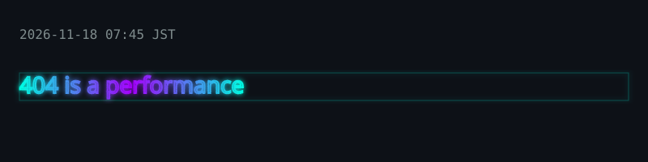

# poicurr

**From pixels to physics. Mostly C++.**

Real-time Graphics · Simulation · Systems Programming

## Selected Work

| Project | Description |
|---|---|
| [DokuText](https://github.com/poicurr/DokuText) | Text shaping, layout, and emoji rasterization |
| [DokuTexture](https://github.com/poicurr/DokuTexture) | BC7 encoding and KTX2 texture tools |
| [CppFromScratch](https://github.com/poicurr/CppFromScratch) | C++20 data structures built from scratch |
| [FindIcon](https://github.com/poicurr/FindIcon) | Offline Nerd Fonts explorer |

## Current Interests

C++20/23 · Vulkan · Real-time Rendering · Physics Simulation

## GameEngine

